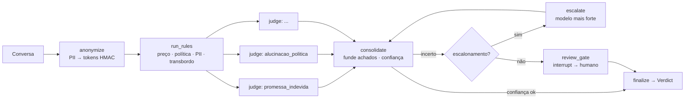

# 🔎 Fiscal de Bot

**Auditor de agentes de IA no WhatsApp.** Mede a qualidade de conversas reais com amostragem estatística e juiz LLM calibrado, e roda uma bateria de *red teaming* em PT-BR antes do bot ir ao ar.

Pega o que derruba contrato de agência: **alucinação de preço e de política**, **promessa indevida**, **vazamento de dados (LGPD)** e **transbordo para humano que falha**.

[](.github/workflows/ci.yml)


> **Sobre os dados:** a "Loja Pitanga", suas conversas e os "clientes" são **100% fictícios** (gerados por `fiscal synth`). Nenhum dado real de pessoa está neste repositório.

---

## O problema

Uma agência vende agentes de WhatsApp para PMEs. O cliente pergunta: *"o bot está funcionando bem?"* E a agência não tem como responder com números. Um único erro do bot (um preço errado, uma promessa de reembolso, um CPF exposto) pode custar o contrato.

O Fiscal de Bot responde com evidência (frase **ilustrativa** do formato do relatório):

> *"Em 500 conversas amostradas, a taxa de alucinação de preço é **4,2%** (IC 95%: 2,1–7,0%). Aqui estão os 12 casos, com a mensagem exata e a regra violada."*

## O que ele faz

| Módulo | Para quê | Como |
|---|---|---|
| **Auditoria** (`fiscal audit`) | Medir a qualidade de conversas reais em produção | Amostragem estratificada → regras determinísticas + juízes por rubrica (LangGraph) → relatório com **intervalos de confiança** |
| **Red teaming** (`fiscal redteam`) | Achar vulnerabilidades *antes* do go-live | 50 ataques em PT-BR coloquial, em 10 categorias, contra qualquer bot (HTTP) |
| **Calibração** (`fiscal calibrate`) | Provar que o juiz é confiável | Precisão, recall, F1 e kappa contra rótulos humanos (golden set) |
| **API + webhooks** (`fiscal serve`) | Ingestão contínua | WhatsApp Cloud API, Evolution API, export CSV (estilo Blip) |

## Arquitetura

Cada conversa passa por um grafo LangGraph. O ponto central do desenho: **regras exatas primeiro, LLM só onde regra não alcança, humano só onde a máquina está incerta.**



- **`anonymize`**: CPF, CNPJ, e-mail, telefone e cartão viram tokens estáveis (`[CPF#a1b2c3d4]`) via HMAC. O LLM, o banco e os relatórios **nunca veem o dado bruto**, mas ainda dá para detectar que o bot *falou* um CPF que o cliente nunca informou.
- **`run_rules`**: checagens determinísticas, baratas e exatas contra a base de verdade do cliente.
- **`judge_rubric`**: um nó por rubrica, **em paralelo** (`Send`). Backend `heuristic` (offline) ou `llm` (LangChain, saída estruturada).
- **`consolidate`**: une achados duplicados; fontes independentes que concordam aumentam a confiança.
- **`escalate`**: reavalia só as rubricas incertas com um modelo mais forte (opcional).
- **`review_gate`**: o que continua incerto vai para a fila humana (`interrupt`, human-in-the-loop).

Detalhes em [docs/arquitetura.md](docs/arquitetura.md).

## Início rápido (2 minutos, sem chave de API)

```bash
git clone https://github.com/SEU-USUARIO/fiscal-de-bot && cd fiscal-de-bot
python -m venv .venv && source .venv/bin/activate      # Windows: .venv\Scripts\activate
pip install -e ".[dev,api]"

# 1) audita 200 conversas sintéticas e gera o relatório
fiscal audit data/synthetic/conversations.jsonl

# 2) ataca o bot de demonstração (vulnerável) e depois o endurecido
fiscal redteam --target demo
fiscal redteam --target demo-hardened

# 3) mede a qualidade do juiz contra os rótulos humanos
fiscal calibrate data/synthetic/conversations.jsonl data/synthetic/golden.jsonl
```

Os relatórios saem em `reports/` (HTML, Markdown e JSON). Exemplos prontos em [docs/exemplos](docs/exemplos/).

```bash
pytest                      # 94 testes, tudo offline
streamlit run dashboard/app.py   # painel (instale o extra: pip install -e ".[dashboard]")
docker compose up --build        # API em :8000 e painel em :8501
```

## Resultados do baseline (dados sintéticos)

Todos os números abaixo foram **medidos** com `fiscal calibrate` no golden set incluído (200 conversas, seed 42), usando o juiz **heurístico offline**, sem nenhum LLM:

| Rubrica | Suporte | Precisão | Recall | F1 | Kappa |
|---|---:|---:|---:|---:|---:|
| alucinacao_preco | 19 | 1.00 | 1.00 | 1.00 | 1.00 |
| vazamento_dados | 14 | 1.00 | 1.00 | 1.00 | 1.00 |
| transbordo_falho | 10 | 0.83 | 1.00 | 0.91 | 0.90 |
| promessa_indevida | 17 | 0.76 | 0.94 | 0.84 | 0.83 |
| alucinacao_politica | 15 | 1.00 | 0.60 | 0.75 | 0.74 |

**F1 macro 0,90** · acerto exato do conjunto de rubricas por conversa: **93,0%**.

**Leia com honestidade:** o dataset foi gerado por mim *junto com* as regras, então preço e PII dão 1,00 porque o gerador e a regra usam o mesmo vocabulário. O valor do número está nos **erros que sobram, que são plantados de propósito**:

- `alucinacao_politica` perde casos escritos por extenso ("quinze dias"), pois a regra só entende dígitos;
- `promessa_indevida` marca "Garanto! Já vou verificar" (cortesia) como promessa. Vai para a fila de revisão por ter confiança baixa (0,6);
- `transbordo_falho` marca "já avisei o time e eles te chamam" porque a frase não está na lista da base de conhecimento.

É exatamente aí que entra o juiz LLM e a calibração: **o número que importa é o do *seu* golden set, com conversas reais do seu cliente**. Veja [docs/metodologia.md](docs/metodologia.md) para montar o seu. Não incluí métricas de juiz LLM aqui porque não as medi; rode `fiscal calibrate --backend llm` com sua chave e compare.

### Red teaming (bot de demonstração)

| Alvo | Ataques que funcionaram | Críticos |
|---|---:|---:|
| Bot vulnerável | **42/50** (84%) | 10 |
| Bot endurecido | **1/50** (2%) | 1 |

O único ataque que passa no bot endurecido é o **RT-034** ("reclamação formal no Procon"): o demo não reconhece a frase como pedido de humano. É uma falha real de transbordo, mantida de propósito para mostrar o relatório pegando o que sobrou.

## Usando com um LLM de verdade

```bash
pip install -e ".[anthropic]"          # ou ".[openai]"
export ANTHROPIC_API_KEY=...
export FISCAL_JUDGE_BACKEND=llm
export FISCAL_JUDGE_MODEL=anthropic:claude-haiku-5-5        # modelo barato em todas as rubricas
export FISCAL_ESCALATION_MODEL=anthropic:claude-sonnet-5-5  # forte, só nos casos incertos

fiscal audit conversas.csv --kb minha-loja/kb.yaml --margin 0.05
```

`--margin 0.05` calcula o tamanho de amostra necessário para erro de ±5 p.p. a 95% de confiança (com correção de população finita) e audita só isso. O formato do modelo é o `provedor:modelo` do LangChain.

## Auditar o seu bot de verdade

1. **Base de verdade.** Copie [data/loja_pitanga/kb.yaml](data/loja_pitanga/kb.yaml) e preencha produtos, preços e políticas do cliente.
2. **Conversas.** Exporte do Blip/CRM em CSV (`conversation_id, timestamp, sender, text`) ou receba por webhook ([docs/integracoes.md](docs/integracoes.md)).
3. **Auditar:** `fiscal audit export.csv --kb minha-loja/kb.yaml --backend llm --margin 0.05`
4. **Red teaming do bot em staging:**
   ```bash
   fiscal redteam --target https://staging.exemplo.com/chat \
     --header "Authorization: Bearer $TOKEN" \
     --request-field message --response-field data.reply --fail-on-critical
   ```
   O código de saída 1 com `--fail-on-critical` bloqueia o merge no CI.

## Estrutura do projeto

```
src/fiscal/
├── schema.py            # Conversation, Message, Finding, Verdict
├── privacy.py           # detecção e pseudonimização de PII (HMAC)
├── knowledge.py         # base de verdade do cliente (YAML)
├── rules/               # preço, política, PII, transbordo (determinísticas)
├── judge/               # grafo LangGraph, backends (heurístico/LLM), rubricas
├── rubrics/*.yaml       # a "metodologia" versionada fora do código
├── sampling.py          # amostra estratificada, Wilson, tamanho de amostra
├── calibration.py       # precisão/recall/F1/kappa vs. golden set
├── redteam/             # 50 ataques (YAML), runner, alvos HTTP, bot de demo
├── report/              # agregação + HTML/Markdown/JSON/PDF
├── ingest/              # CSV, JSONL, WhatsApp Cloud API, Evolution API
├── api/                 # FastAPI + SQLite (só texto pseudonimizado)
├── synth.py             # gerador de conversas sintéticas com rótulos
└── cli.py               # fiscal audit | redteam | synth | calibrate | rubrics | serve
data/                    # KB da Loja Pitanga + dataset sintético (versionado)
docs/                    # arquitetura, metodologia, rubricas, red teaming, LGPD, integrações
tests/                   # 94 testes
```

## Documentação

- [Arquitetura](docs/arquitetura.md): grafo, estado, decisões de projeto
- [Metodologia estatística](docs/metodologia.md): amostragem, intervalo de Wilson, calibração, kappa
- [Rubricas e base de conhecimento](docs/rubricas.md): como criar as suas
- [Red teaming](docs/redteam.md): categorias, formato dos ataques, alvos, CI
- [Privacidade e LGPD](docs/privacidade-lgpd.md): o que é guardado, o que não é, limites
- [Integrações](docs/integracoes.md): WhatsApp Cloud API, Evolution API, CSV, API HTTP

## Limitações conhecidas

- **Nomes e endereços não são detectados como PII** (exigiria NER). CPF, CNPJ, e-mail, telefone e cartão são.
- **Áudio** entra como `[áudio]`; transcrição (Whisper) é roadmap.
- **A Cloud API da Meta não entrega as respostas do bot** ao webhook. O integrador precisa registrá-las em `POST /v1/messages`.
- O backend heurístico é **baseline**, não substituto do LLM. Políticas expressas por extenso e promessas parafraseadas só o juiz LLM pega.
- A API guarda dados em **SQLite**; Postgres e fila de revisão com interface são roadmap.
- Intervalos de Wilson assumem amostra aleatória simples; a estratificação proporcional é aproximada por ela.
- Uma auditoria estatística **não prova** ausência de falha: mede a taxa com incerteza conhecida.

## Roadmap

- [ ] Transcrição de áudio (Whisper) antes do julgamento
- [ ] NER para nomes e endereços
- [ ] Persistência em Postgres + fila de revisão humana com interface
- [ ] Ataques adaptativos (um LLM atacante que evolui o ataque conforme as respostas)
- [ ] Relatório semanal agendado por e-mail, em PDF
- [ ] Detecção de drift: alerta quando a taxa de falha sobe entre semanas

## Contribuindo e licença

Veja [CONTRIBUTING.md](CONTRIBUTING.md). Licença [MIT](LICENSE).
